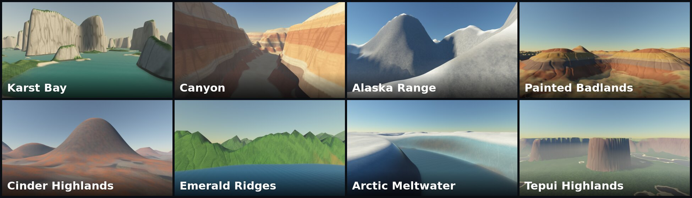

# Phonics Examples

Independent games built with [Phonics](https://github.com/seanmorris/php-wasm-engine). Each game owns the resources and engine conventions it actually needs. The repository publishes a full-page experience and a minimal iframe surface for every example.

The catalog contains Sane-Phonics, PHP-Noid, PHPTris, PHP Slalom, PHP Buster, Doom-Phonics, **PHP Billiards**, **PHP Poker**, Phlappy Phant, RPSC, and **Landscape Sandbox**. Billiards and Poker are direct executable applications. Tiled worlds and WADs remain resources of the games that need them rather than requirements of the examples framework.

PHP Poker offers Bicycle-inspired five-card draw, Texas Hold'em and five- and seven-card stud against local opponents, with automatic opponent adaptation and saved-game continuation. Its full page becomes available offline after the complete game and runtime have been verified. The same games play heads-up online over Matrix, with a jointly shuffled deck that neither browser can read.

RPSC is Rock Paper Scissors Checkers against the computer or another person online. It reuses Poker's private-deck primitive for placements: each browser proves its twelve hidden pieces are four of each kind without showing where they stand.

Landscape Sandbox is a 20-mile-square procedural world written in PHP. Sculpt it, lay roads that cut and fill the ground, and cross it in a 240 mph car, an F5 or a watercraft. It finds closed circuits in the terrain, and a computer driver races them in the same car. [How the sandbox works](games/terrain-sandbox/docs/how-it-works.md) describes how PHP and the GPU compute the same surface.



```sh
npm install
npm test
npm run build
npm run serve
```

Each game lives under `games/<slug>/`. Its `example.json` declares the application, canvas, poster, documentation chapters, and embed mode. `npm run build` generates assets, packs every application, and writes the GitHub Pages artifact to `site/dist`. Open `/games/<slug>/` for a full page or `/embed/<slug>/` for the iframe surface.

The main Phonics documentation build imports these chapter files and API metadata directly. Set `PHONICS_EXAMPLES_ROOT` to this checkout when developing both repositories together; CI can fetch the repository and ref declared by the engine's `site/examples-source.json`.
