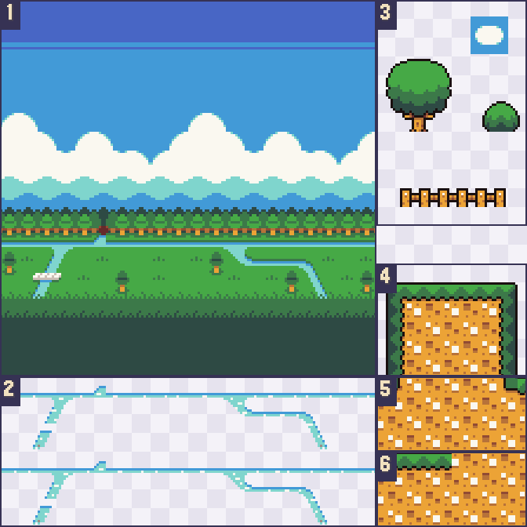
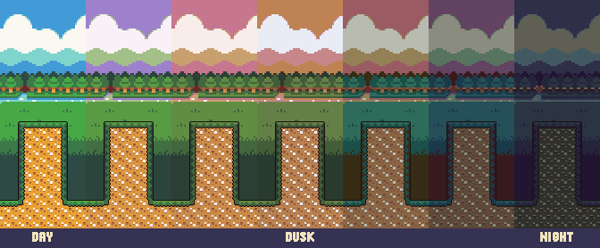

# Art and the day cycle

Everything the game draws, apart from text, comes from six hand-edited PNG sheets in `art/`. One script, `scripts/generate-phant-sprites.mjs` at the repository root, cuts them into tilesets, grades the palettes between day, dusk, and night, synthesizes the three sounds, and composes the catalog poster. Changing the art means editing a sheet and running the script again; no PHP changes are needed while the sheets keep their layout.

## Source sheets

| Sheet | Size | Contents |
| --- | --- | --- |
| `art/elephpant.png` | 128×104 | The four elephant frames, traced by hand from `art/elephpant.svg`. |
| `art/cardinal.png` | 96×32 | Three 32×32 flight frames of the cardinal that crosses the daytime sky, facing left. |
| `art/terrain.png` | 224×224 | The daytime backdrop, its river animation, the pillar, the ground, and the scenery. |
| `art/terrain-parallax.png` | 224×224 | The same layout with the backdrop painted as flat bands that mark its parallax layers. |
| `art/terrain-duskdawn.png` | 224×224 | The whole terrain sheet graded by hand for dusk and dawn. |
| `art/terrain-night.png` | 224×224 | The whole terrain sheet graded by hand for night. |

The elephant sheet holds two rows of two 64×52 frames. The left column has the wing folded and the right column has it spread. The top row faces right and is used in flight. The bottom row faces left and is used for the tumble after a bonk, where a mirrored sprite would show the lettering on its side backward.

## The terrain sheet

The terrain sheets share one layout on a 32-pixel grid. The pillar, ground, and scenery were drawn on a 16-pixel grid and are cut on an 8-pixel one, which is why every gap edge in the game sits on a multiple of 8.



| Region | Contents | How it is cut |
| --- | --- | --- |
| 1 | Backdrop, 160×160. | Drawn whole at twice the size of the other tiles, one parallax band at a time. |
| 2 | Two river frames, 160×32 each. | Each is laid over the backdrop's fourth row to make the two frames of a 400 ms animation. |
| 3 | Scenery: a tree, a shrub, and a fence. | Three pieces whose bottoms rest on the 8-pixel grid, so they stand on the ground line. |
| 4 | The pillar: a grass cap, then walls. | An 8-pixel cap slice and two 8-pixel wall slices. The dirt pattern repeats every 16 rows, so alternating the two wall slices continues it at any height. |
| 5 | The row where a pillar meets the ground. | Its top 8 pixels close the pillar's outline into the grass. |
| 6 | Ground: a grass-topped tile and plain dirt. | Two 32×32 tiles, tiled along the bottom of the frame. |

The pillar is 56 pixels wide with 4 clear pixels on each side of its 64-pixel slices, and `Simulation::PILLAR_W` is 56 to match. The collision box and the drawn outline are the same rectangle.

A pair of pillars is the same pillar twice. The one on the ground is stacked upward from its base; the one in the sky is the same stack flipped vertically, so its grass cap faces the gap.

## The parallax mask

`art/terrain-parallax.png` repeats the layout, but its backdrop is painted in flat horizontal bands. The generator reads the rows where the color changes and treats each band as one layer. The current mask has five:

| Band | Sheet rows | Contents | Scroll rate |
| --- | --- | --- | --- |
| 1 | 0–71 | Sky and clouds | 0.08 |
| 2 | 72–79 | Far haze | 0.16 |
| 3 | 80–87 | Near haze | 0.24 |
| 4 | 88–129 | Treeline, field, and river | 0.45 |
| 5 | 130–159 | Hedge | 0.7 |

A rate is a fraction of the ground's speed, so distant bands drift slowly and the hedge nearly keeps pace with the pillars. The rates are the `PARALLAX` list in the generator. Repainting the mask moves the band edges without touching code; adding or removing a band needs a matching entry in that list, and the generator stops with a message when the two disagree.

The mask's foreground column also supplies the daytime pillar, ground, and scenery, so touch-ups to those go in the mask sheet while daytime backdrop changes go in `art/terrain.png`.

## Day, dusk, and night

The day cycle is painted, not computed. A multiply tint cannot remove the yellow from the dirt or push the greens toward navy, so dusk and night are complete hand-graded copies of the terrain sheet. The graded sheets must keep exactly the shapes of the day sheet. The generator compares every pixel's transparency and stops at the first difference, because the game fades between palettes and a moved outline would show as a ghost.



Fading straight from one hand-graded sheet to the next goes wrong halfway. The day sky is blue and the dusk sky is gold, and an even mix of the two is gray. The generator therefore grades two in-between palettes for each leg of the cycle, which gives seven palettes in all. Each pixel is interpolated in OKLCH, a color space where lightness, colorfulness, and hue are separate, so a pixel keeps its saturation while its hue travels around the wheel instead of cutting through gray.

The direction of travel matters. When a pixel's hue swings more than 90 degrees and either end is a warm color, the hue goes around through the reds and pinks. That is what makes the sky pass through mauve and coral on the way to dusk, and through rose and plum on the way to night. Every other pixel takes the shorter way, so green foliage reaches night navy through teal without browning first. A nearly gray pixel has no meaningful hue and borrows the hue of the other end.

At run time the simulation only says day or night. The renderer eases along the two legs, 1.4 seconds each, warming to dusk before it darkens, and runs the same path backward for dawn. At any moment it draws two neighboring palettes blended per pixel, so even the seven steps do not show. The elephant is not on the terrain sheets, so it takes a light tint instead: none by day, warm at dusk, and cool at night.

## What the generator writes

| Output | Tiles | Notes |
| --- | --- | --- |
| `assets/phant.png` and `.tsj` | 4 at 64×52 | Right-facing folded and spread, then left-facing folded and spread. |
| `assets/backdrop.png` and `.tsj` | 14 at 160×160 | Seven palettes, two river frames each, with the animation declared in the tileset. |
| `assets/cardinal.png` and `.tsj` | 3 at 32×32 | The cardinal's wing-down, level, and wing-up frames, with their animation. |
| `assets/pillar.png` and `.tsj` | 28 at 64×8 | Seven palettes of cap, two wall slices, and base. |
| `assets/ground.png` and `.tsj` | 14 at 32×32 | Seven palettes of grass and dirt. |
| `assets/scenery.png` and `.tsj` | 21 at 48×32 | Seven palettes of tree, shrub, and fence, each aligned to the bottom left of its cell. |
| `assets/flap.wav`, `ding.wav`, `bonk.wav` | | Synthesized 22,050 Hz mono effects. |
| `poster.png` | | The 1280×720 catalog poster. |
| `docs/terrain-sheet.png`, `docs/day-cycle.png` | | The two figures in this chapter. |

Layout data travels with the art as custom properties on the tilesets, and `Render\Scene` reads it when it loads the map:

| Tileset | Property | Meaning |
| --- | --- | --- |
| Backdrop | `phlappy.bands` | The band edges read from the mask, in sheet rows. |
| Backdrop | `phlappy.parallax` | One scroll rate per band. |
| Backdrop | `phlappy.steps` | Palettes per leg of the cycle: the hand-graded one and its in-betweens. |
| Backdrop | `phlappy.skies` | The top-left pixel of each palette, used to fill the sky above the backdrop in tall frames. |
| Scenery | `phlappy.widths` | The drawn width of each scenery piece, for culling at the frame's edges. |

## Changing the art

Edit a sheet, then regenerate and repack from the repository root:

```sh
node scripts/generate-phant-sprites.mjs
npx phonics integrity games/phlappy-phant
npx phonics pack games/phlappy-phant
```

The first command rewrites every output in the table above. The second refreshes the file hashes in `phonics.json`, and the third rebuilds `dist/game.phar`. `node scripts/generate-phant-sprites.mjs --check` rewrites nothing and fails when a committed output no longer matches its sheet; `npm run check:generated` runs it with the other games' generators. Adding `--preview <directory>` also writes enlarged copies of each tileset for inspection.

Every output is deterministic, down to the noise in the bonk, so the check compares bytes.

The generator stops with a message when a sheet breaks the layout:

- A sheet has the wrong size.
- A graded sheet's shapes differ from the day sheet; the message names the first pixel.
- A row of the mask's backdrop is not one flat color.
- The number of bands in the mask differs from the number of scroll rates.

One change does reach into the code. The number of in-between palettes is `STEPS` in the generator. Changing it changes how many tiles each terrain tileset holds, so the `firstgid` values in `worlds/phant.tmj` and the matching `GID_` constants in `Render\Scene` have to move with it.
