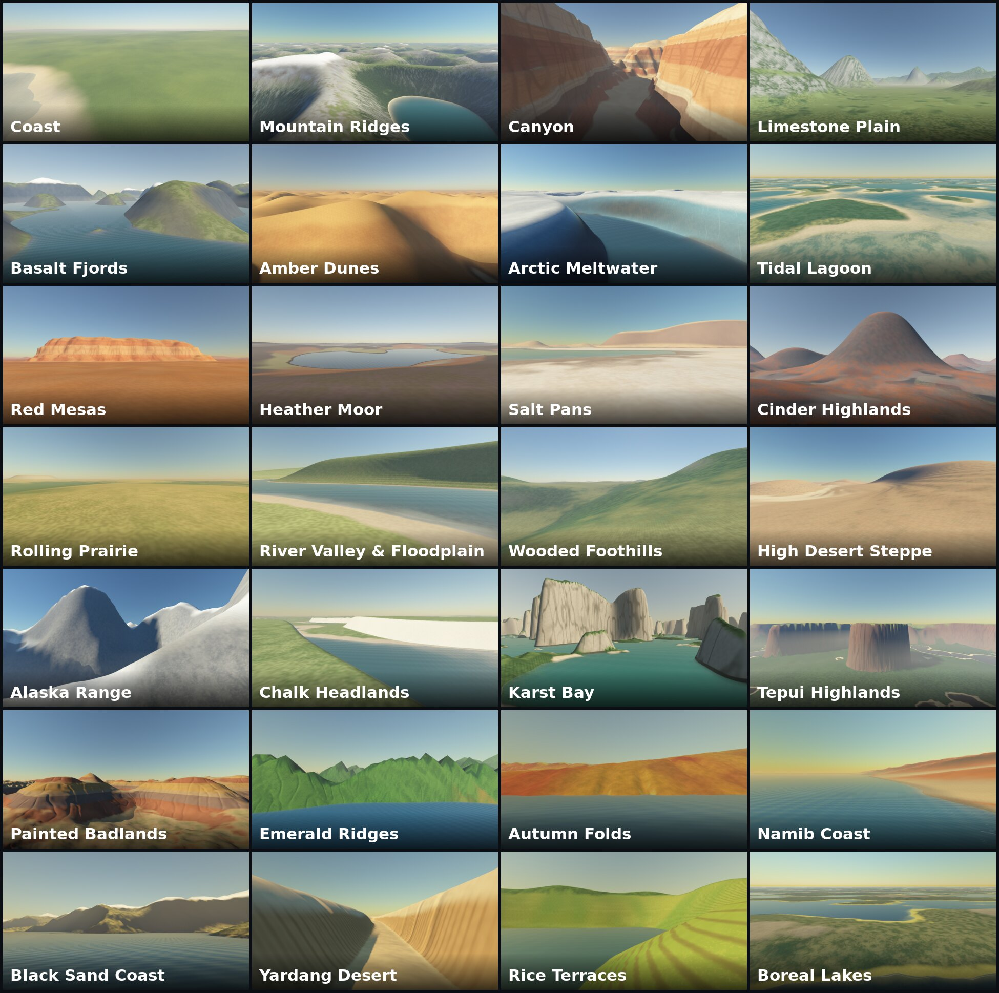
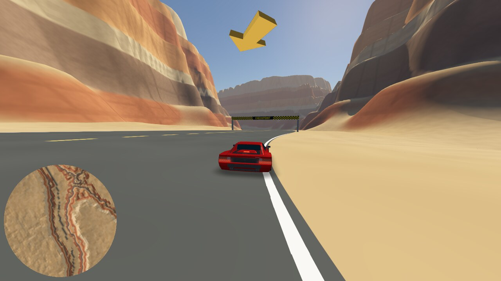

# How it works

Landscape Sandbox is a PHP program. PHP 8.4, compiled to WebAssembly, runs the simulation, the editing tools, the circuit search and the computer driver, and it issues the WebGL 2 draw calls itself. This chapter describes what makes that practical in a browser tab.

## The ground is a function

A landscape is a square 32,768 meters on a side, about 20.4 miles, with a height sample every meter. That is 1,073,741,824 samples across 415 square miles. The sandbox stores none of them.

A recipe holds a seed, one of 28 landform presets and a short list of shape numbers. It defines a function from a position to a height. The sandbox evaluates that function only where something asks: under a wheel, along a ray from the pointer, or across the strip of ground the camera has just exposed.

Saving writes the recipe, your edits and the environment settings. An unedited landscape saves as 12 to 15 kilobytes of JSON, and loading that file reproduces every hill.

A height depends on its position alone. There is no erosion simulation to wait for and no baked grid to download.

## PHP and the GPU compute the same surface

The height function exists twice. The PHP version answers the physics and the editing tools. A GLSL version runs on the GPU and fills the elevation textures that the renderer draws from. If the two disagreed, a car would float above the road you see, or sink into it.

A browser test compares them on cliffs, road banks, intersections and the edges of the world, on single landscapes and where two or three join. It fails if any height differs by more than 5 millimeters (0.2 in), or if the road material at any sample differs.

## Detail follows the camera

The renderer draws a stack of square grids centered on the camera. Each covers more ground at less detail than the one inside it. Every grid reads its heights from a texture that wraps around its edges, so when the camera moves the GPU computes only the newly exposed strip. After a jump across the map the coarse grids appear first and the fine ones follow.

Physics never reads these grids. A wheel asks the PHP function for the ground at one-meter resolution wherever the car is, so the handling stays the same at every detail setting and at any distance from the camera.

## Edits are transactions

A brush stroke, a crater, a painted patch and a road are each an operation added to the landscape's history. A road is a curve with a width, a crown and shoulders. Committing it cuts and fills the surrounding ground to give the pavement a bed. Undo and redo move through whole transactions.

The sandbox prepares each edit on a copy of the landscape while the previous version stays on screen and under the wheels. It then swaps the drawn ground and the physical ground in the same update, so a car cannot hit a road that has not appeared yet.

## A car that slides

The car reaches 240 mph. Each wheel follows the ground on its own spring, and a crest you can roll over slowly will launch the car at speed.

The handbrake locks the rear wheels and swings the tail out. Nitrous, added while the tail is out, pulls the car's path round after its nose and presses the tires into the road. Held together they turn the car far faster than the tires alone can. In one recorded lap of the canyon circuit the car turns 46 degrees in one second while accelerating from 187 to 196 mph.

## A computer driver in the same car

The computer driver has the same four inputs as a player: throttle or brake, steering, handbrake and nitrous. Its car obeys the same physics, and nothing adjusts its speed to keep a race close.

Before the start it fits a racing line inside the painted pavement. It then plans a speed for every 6 meters (about 20 feet) of that line from the car's own equations: how fast a slide can turn the car, how hard the brakes and the air slow it, and how much of the nitrous bottle the bends ahead will need. It predicts each crest with the suspension's spring law and takes off only where the road beyond is straight enough to land on.

Around the 11.6-mile canyon circuit it averages just under 200 mph. [Generate a circuit](index.md#generate-a-circuit) explains how to find a course on any landscape and watch it drive.

## Sky, weather and water

The sky models sunlight scattering through a spherical atmosphere. Moving the sun changes the light on the ground, the color of the sky and the haze over distant terrain together, because all three come from the same calculation.

The cloud sheet, its shadows on the ground and its reflections in the water all sample one moving field. The waves you see and the waves that lift the watercraft come from one function too, evaluated in GLSL for drawing and in PHP for buoyancy.

## What it is made of

The sandbox is about 20,000 lines of PHP. The [terrain package](https://seanmorris.github.io/php-wasm-engine/terrain.html) it builds on is another 20,000, with 3,400 lines of GLSL. About 18,800 lines of PHP tests cover the two. The packaged game is a 9 MB PHP archive.
